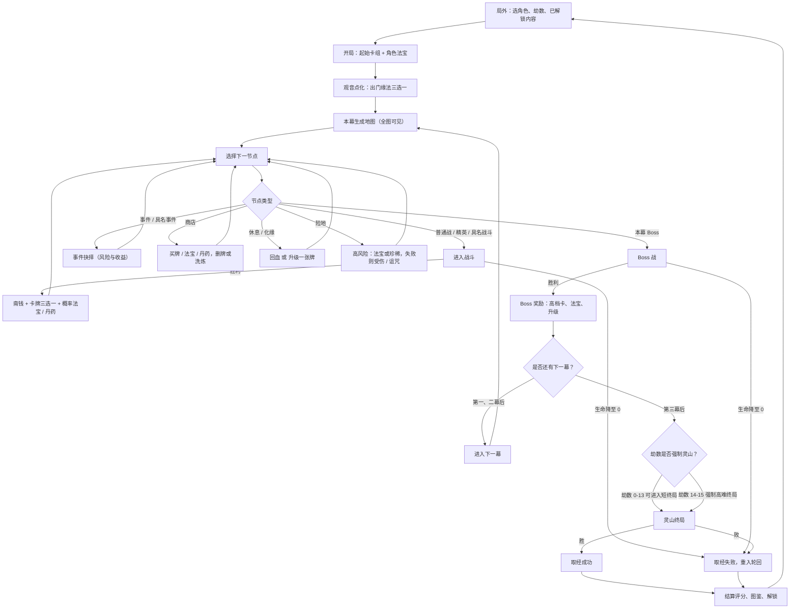

# 西游肉鸽卡牌 · 肉鸽核心循环 v1

> 本文补足 `design-v1.md` 中偏关卡结构、未写清的 **roguelike 核心循环**。  
> 种族、81 难映射、角色与法宝设定仍以那份为准。本文数值均为草案。  
> 叙事包装：一局 = 一次西行取经；阵亡 = 取经失败、重入轮回。

---

## 0. 循环一句话

**局外选角与劫数 → 开局拿起始牌和缘法 → 在随机分支地图上边打边构筑 → 战斗/事件给奖励、店与休息改造牌组 → 三幕加灵山 → 死则整局清零，活则结算、解锁，再开下一轮。**

玩家每局都要从弱起始牌组长出一条能过本局地图和 Boss 的构筑；强度主要来自**这一局**抽到的牌与法宝，而不是局外堆数值。

---

## 1. 单局循环

### 1.1 开局选择

第一版默认流程（角色未全解锁时，未解锁项不出现）：

1. **选角色**（先只有孙悟空；日后八戒 / 沙僧 / 白龙马 / 唐僧）。锁定种族被动与人物特性。
2. **确认劫数**（难度阶梯，见第 5 节）。默认劫数 0；通关后可提升，也可主动降低。
3. **带入起始配置**（不可另选，保证第一局就能走）：
   - 起始卡组约 **10 张**（悟空草案：5 张「棒打」、4 张「身法 / 格挡」、1 张角色种子牌，如「身外身法」或「火眼一瞥」）。
   - **1 件角色起始法宝**（悟空：如意金箍棒）。
   - 起始生命（悟空草案：**70**）、**斋钱 99**、丹药栏 **3**（劫数高时会变少）。
4. **观音点化（出门缘法）**：三选一，类似「开局赐福」，每局重随。草案池：
   - 获得 1 件普通法宝；
   - 从 3 张非凡牌里选 1 张加入牌组；
   - 删除 1 张起始牌；
   - 最大生命 +8 并回满；
   - 额外斋钱 +75；
   - 获得 1 颗丹药并 +1 「功德」。  
   解锁更多角色与高劫数后，池子里可出现更强或更险的选项（如「开局一张珍稀牌，但塞入 1 张诅咒」）。

开局不做「选初始法宝三选一再选卡组」的双重随机，以免第一版选择过载；法宝多样性靠点化和局内掉落。

### 1.2 地图生成规则

一局 **3 幕西行 + 灵山终局**。每幕开始时生成一张 **有向无环的节点图**，本幕全图可见（可规划路线）；「？」与部分险地只显示类型未知，不显示具体遭遇。

**结构草案（每幕）：**

| 层 | 内容 |
|----|------|
| 第 0 层 | 出发营寨，唯一入口 |
| 第 1～12 层 | 可行走层，每层 **2～4** 个节点，只与下一层相连（分叉、合流） |
| 第 13 层 | 固定 **休息 / 化缘**（Boss 前必休） |
| 第 14 层 | 本幕 **Boss**（从本幕 Boss 池抽 1） |

玩家每幕大约走 **13 个节点 + 1 场 Boss**。熟练全长目标仍是 **40～60 分钟**。

**节点权重（第 1～12 层，生成后再做保底修正）：**

| 节点 | 权重 | 限制 |
|------|------|------|
| 普通战 | 42% | 第 1 层至少 1 个普通战 |
| 事件 | 22% | 每幕至少 2 个 |
| 精英 | 10% | 第 1～2 层不出现；每幕至少 1，至多 3 |
| 商店 | 8% | 每幕至少 1；不放在第 1 层 |
| 休息 / 化缘 | 8% | 另有第 13 层保底休息，前段至多再 2 个 |
| 险地 / 宝匣 | 5% | 第 1～3 层不出现；高风险高报酬 |
| 具名难（覆盖） | — | 不占独立权重：从本幕难池抽 **1～2** 个，覆盖到精英 / 事件 / Boss 上，图标可见（如「白虎岭」） |

**分支与路线：** 通常 **2～3 条主路** 时合时分。不保证每条路都有商店或精英——这是关键决策：为精英奖励绕路，可能少休息、多受伤。通天河这类「因果难」若在本局去程触发且未根除，第三幕生成时 **强制植入回程变体**（见 `design-v1.md`）。

**可见性：** 本幕拓扑、节点类型、具名难图标开幕即可见；「？」揭开前不知是事件还是战斗。下一幕地图打完本幕 Boss 后再生成，不能提前看。

### 1.3 战斗后奖励

胜场必结算，顺序固定：**斋钱 → 卡牌三选一 → 掷法宝 → 掷丹药 →（精英/Boss 额外）**。可跳过选卡（不要这张）。

| 来源 | 斋钱（草案） | 卡牌奖励 | 法宝 | 丹药 | 功德 |
|------|--------------|----------|------|------|------|
| 普通战 | 10～20 | 3 选 1（标准稀有度，见 2.1） | 4% | 25%（栏未满） | 0（击杀不自动加功德） |
| 精英 | 25～40 | 3 选 1（非凡权重提高） | **100%**（普通或稀有法宝） | 40% | +1（斩名妖） |
| Boss | 50～80 | 3 选 1（珍稀权重提高）+ 可另得 1 次升级 | **100%**（稀有或传说） | 50% | +3 |
| 险地 | 视结果 | 常为 1 件法宝或 1 张珍稀，但先付生命 / 诅咒 | 高 | 低 | 视选择 |

**斋钱**：局内商店货币，本局结束清零。  
**功德**：局内第二资源，主要来自事件里的「救、劝、让、不贪」等选择，不靠无脑清图。用于寺庙服务（去诅咒、看破、部分佛门选项门槛），并计入结算分。不是第二套万能金币。

普通战法宝掉率刻意压低，强度曲线交给精英 / Boss / 事件 / 点化。

### 1.4 卡牌升级、删牌、洗炼

牌组变强靠 **加好牌、砍废牌、升级关键牌、偶尔洗炼变牌**，四件事要分散在不同节点，避免一个休息点做完所有养成。

| 操作 | 哪里做 | 规则草案 |
|------|--------|----------|
| **升级**（默经） | 休息点主选项；Boss 后可白给 1 次；商店可买 | 选牌组中 1 张未升级牌，变为「+」。伤害 / 护甲类约 +3，或解锁额外效果。一局同 1 张只升 1 次。 |
| **删牌** | 商店常驻；少数事件 | 从牌组移除 1 张（可删起始牌与诅咒，诅咒价更高）。令牌组更薄、更稳。 |
| **洗炼** | 商店付费服务；五庄观、炼丹事件 | 两种（商店每次只开一种，随机）：**炼化**——把 1 张牌变成同稀有度的另一张（结果随机，不可悔）；**重随奖励**——仅对下一次战斗选卡免费重随 1 次。不在休息点做，以免节奏塌成「每场都重随」。 |

建议第一版 **不做「同一张牌两条升级分支」**，先保证 + 牌信息清晰。

### 1.5 商店定价

每幕至少 1 个商店。货架草案：卡牌 5 张、法宝 2 件、丹药 2 颗，外加固定服务「删牌」「洗炼」，偶发「升级一张（高价）」。

| 商品 / 服务 | 斋钱售价（草案） | 备注 |
|-------------|------------------|------|
| 普通牌 | 50～60 | |
| 非凡牌 | 80～125 | |
| 珍稀牌 | 150～200 | |
| 普通法宝 | 150～180 | |
| 稀有法宝 | 220～280 | |
| 丹药 | 50～70 | 栏满则不可买 |
| 删牌 | 首次 75，每次再删 +25 | 删诅咒 +50 |
| 洗炼（炼化） | 90 | |
| 商店内升级 | 100 | 每店限 1 次 |

进店时可花 **5 功德** 请店中僧人「开光」：本店卡牌刷新 1 次（每店限 1）。高劫数下物价上调（见第 5 节）。

### 1.6 休息 / 化缘：二选一

进休息点必须选一项（可跳过，但不建议作为常态）：

1. **化缘回血**：回复 **最大生命的 30%**（人族再加 `design-v1.md` 的 8%）。生命已满则这项收益为 0，应去默经。
2. **默经升级**：升级牌组中 1 张牌。

有特定法宝或高功德时，可解锁第三选项（不做进第一版必做）：例如「坐禅」——失去 15% 生命，移除 1 张诅咒。

Boss 前那次休息是本幕最后一次稳定升级 / 回血，路线规划的核心之一。

### 1.7 事件的风险与收益

事件是「不走战斗也能改牌组与资源」的主通道，必须让选择有代价，避免全是正收益文本。

**结构：** 多数事件 2～3 个选项，至少 1 个带风险或机会成本。结果可在选项上部分明示（「约 50% 得法宝，失败则受伤」），具名难事件可以藏得更深（如假佛赐福）。

**收益预算（相对一场普通战）：** 纯平安选项应略低于一场普通胜的期望（例如只回 12 生命，或只得 20 斋钱）；高风险选项的成功期望可接近一场精英（法宝 / 珍稀牌），失败则相当于挨一次重击（失去 20%～30% 生命，或塞 1 张诅咒）。

**举例（与 81 难挂钩）：**

| 事件 | 稳妥选项 | 冒险选项 | 可能的因果 |
|------|----------|----------|------------|
| 五庄观人参果 | 路过，得少量斋钱 | 偷吃：永久 +8 最大生命，50% 触发镇元子问罪（战斗或耗资源医树） | — |
| 女儿国招亲 | 拒婚，可能打一场追兵 | 受赠：回满血 + 1 张非凡，但加入诅咒「情丝」 | 错过或改写本幕店 |
| 陈家庄 / 通天河 | 代战救童，耗生命或打一场，+3 功德 | 无视，直接过河（省资源） | 第三幕可能回程索命 |
| 借芭蕉扇 | 送礼、求情（耗斋钱 / 功德） | 抢或骗，可能得假扇，再强制开打 | 改变火焰山环境规则 |
| 小雷音「赐福」 | 不受供，可能开打 | 接受：下 2 场牌费 -1，实为诅咒或黄眉伏笔 | 识破则按妖结算 |

同一事件在不同角色 / 种族 / 是否持有火眼金睛时，应尽量多 1 个专属选项（不必第一版全做，先给悟空 + 火眼）。

---

## 2. 随机性与构筑

### 2.1 卡牌稀有度与出现概率（含保底）

三档：**普通 / 非凡 / 珍稀**（对应常见、少见、稀有）。奖励里的 3 张牌 **各自独立掷稀有度**，再从该角色可用牌池（含已解锁的中立牌）抽具体牌，尽量 3 张不重复。

**基础权重：**

| 场合 | 普通 | 非凡 | 珍稀 |
|------|------|------|------|
| 普通战胜、标准选卡 | 60% | 37% | 3% |
| 精英战胜 | 45% | 45% | 10% |
| Boss 战胜 | 20% | 50% | 30% |
| 商店货架单张 | 50% | 40% | 10% |

**悲悯（保底），防止一整局不见珍稀、或连续全是普通牌：**

- **珍稀悲悯：** 每经过 1 次「卡牌奖励结算」且 3 张里没有珍稀，则下一次奖励的珍稀率 **+1.5%**（从普通里扣）。一旦出现珍稀，倍率清零。按此，大约 15～20 次选卡仍不保出，但期望会明显抬起来。
- **非凡保底：** 若连续 **2** 次卡牌奖励的 3 张全是普通，则下一次至少有 **1** 张以非凡起掷（仍可能升到珍稀）。
- 以上只对「战斗后 3 选 1」生效；商店货架单独掷，不用这套保底，以免店里必出好牌。

玩家可以 **跳过选卡**；跳过仍计一次结算（珍稀悲悯照加），避免靠空刷保底。

### 2.2 悟空的三条流派（第一版先做透）

三条约定：**起始牌里都有种子，但必须靠局内牌与法宝才能成型**；允许杂交，不强制纯净。以下「核心牌 / 法宝」是方向，不是完整卡表。

**① 分身流（身外身法）**

- 想法：多体、多次出手，用数量触发「凶芒」与击倒叠妖气。
- 核心牌：身外身法（召唤分身：本回合多打 1 次攻击，或生成 0 费「分身击」）、毫毛、连击、群打。
- 关键法宝：能「每打出 X 张攻击就……」或「每回合第一次攻击重复」的物件；与大圣被动（第一张攻击重复）天然同向。
- 弱点：牌多易空费、怕 AoE 与封印；需要删牌或过牌来稳住费用。

**② 金箍棒变化流（如意）**

- 想法：围绕「棒」牌把单击做大。金箍棒可长可短：加费加伤、或减费多次。
- 核心牌：棒打及其升级、定海神珍（本局每升过 1 张棒牌则伤害 +1）、千钧、扫荡。
- 关键法宝：如意金箍棒（攻击或「棒」牌 +2）、能升级更多或「伤害随本局已升级牌数增长」的法宝。
- 弱点：前期瘦，要靠休息默经和删掉多余身法牌；怕缴械（金刚琢）和收缴法宝。

**③ 火眼金睛破甲流（看破）**

- 想法：剥护甲、看破假形，专克精英、鬼、假佛；打「有格挡 / 有变形」的目标额外结算。
- 核心牌：火眼一瞥（看破：本回合对敌伤害无视护甲，或给「破隐」）、金睛、破魔、揭谛。
- 关键法宝：火眼金睛（精英与变形提示；常与破甲牌联动：对处于破隐的敌人伤害 +3）、杨枝净瓶等佛门件（走妖体佛用的混合）。
- 弱点：对无护甲的纯血怪一般；牌效偏条件。高劫数里精英变多时这条会升值。

开局那张角色种子牌可在「身外身法 / 火眼一瞥」间做极轻随机或由点化决定倾向，但不要开局就锁死一条，否则随机构筑的意义变弱。

### 2.3 法宝与卡牌的联动

法宝是「这局 Build 的味道」的主开关：同一套攻击牌，有棒则走变化流，有「每打出 3 张攻击抽 1」则走分身流。

设计约束：

- 每件法宝应能让 **至少一类牌** 明显变强，而不是只加光秃数值（纯 +1 攻可以有，但只能做普通法宝）。
- 传说法宝可改变规则（芭蕉扇关酷热、葫芦收小怪、金刚琢反制技能）。
- 避免「无此法宝则某条流派完全不能玩」；法宝是加速器，核心牌本身要能凑合打完低劫数。

例子：火眼金睛 + 破甲牌；如意金箍棒 + 棒牌升级；锦襕袈裟给破甲流提供站场；紧箍儿给分身流减费但带反噬。

### 2.4 种族特性对构筑的影响

种族不是又一套职业，而是 **选牌时的倾向与对局修正**：

- **悟空（妖）**：凶芒鼓励「打残再补刀」和击倒加速，分身流、棒流都吃这套；对佛敌人要改计划（追加伤害被关）。佛缘分支解锁后可掺佛牌，用护体补身板，但不改妖本相。
- **人**（唐僧若可玩）：事件与化缘更优，宜走薄组、经文、去诅咒；输出靠法宝与计策，不靠妖气雪球。
- **龙**（白龙马）：水系、护甲、环境（通天河）是主轴，单点棒流不合适。
- **选牌池**：角色本族标签牌权重要高于泛用牌；佛牌对妖主角不是不能出，但应更多来自事件 / 高功德 / 佛缘，而不是和妖术一样常见。
- **对敌人种族**：见鬼就带看破与符箓，见火妖带水，是「这一局地图信息 → 临时偏科」，不是必须长盘克制。

---

## 3. 永久死亡与重开

- **战斗中生命降至 0：本局立即结束。** 牌组、斋钱、法宝、丹药、本局功德全部清空。这是肉鸽的压力来源，不做「检查点读档从本幕头再来」（可另做练习模式，不进图鉴成就）。
- **还魂丹** 是唯一的局内例外：持有则改为保留 30% 生命并消耗丹药，本局继续。高劫数可削弱或不开这颗丹。
- 叙事：推倒「西行败止」画面——取经失败，师徒失散，**重入轮回**。再开一局是下一次西行，不是读档。
- 「唐僧被劫」若做成额外失败条件，也走同一套结算（第一版可不做，以免双失败条件把规则搅糊）。

**结算评分（草案，通关与失败都给）：**

| 项 | 分 |
|----|----|
| 每过 1 幕 | +100 |
| 击败本幕 Boss | +50 |
| 通关灵山终局 | +200 |
| 剩余生命（按比例） | 最多 +50 |
| 本局功德 | 1 功德 +2 |
| 具名难度过（打过或合法绕过） | 每难 +15 |
| 劫数 | 每级 ×1.1 总倍（或 +20 / 级） |
| 失败 | 按已完成层数给上述部分分，无终局奖 |

评分主要用于本局战报、排行与解锁阈值，不直接换成永久攻击力。

---

## 4. 局外成长

局外只解决 **「下一局能玩到新东西」**，不解决 **「下一局天生更能打」**。

### 4.1 解锁内容

通关、失败达幕数、第一次遇到某事件、评分达标时，向总池加入新内容（下一次西行才生效）：

- **角色**：先悟空；例如首次通关劫数 0 解锁八戒，再通关解锁沙僧，等等。
- **卡牌 / 法宝**：角色牌池初期只放约一半，其余用「第一次打出某类牌 / 遇到某难 / 通关」解锁，避免首周目信息过载，也给重开新鲜感。
- **出门缘法选项**：高劫数或成就解锁更险的点化。
- **新的难进入遭遇池**：未解锁的具名难不进地图（用无名小妖战占位）。解锁后，对应幕才可能刷出白骨精、火焰山、女儿国等。第一版先放 8～12 个具名难在池里，其余后补解锁。

### 4.2 八十一难图鉴

跨周目永久记录：见过、度过（战胜或合法事件解决）、因果变体（如通天河去程 / 回程）、未根除。

- 图鉴是长线收集目标，**不要求一局集齐 81**。
- 新解锁的难「第一次被抽进地图」时，图标可带「新」标记。
- 齐套可以给一个称号 / 缘法 / 装饰，或解锁进阶终局入口，**不要给永久攻击或生命**（见下）。

### 4.3 永久数值加成：建议基本不给

**建议：不提供可叠加的永久生命、伤害、斋钱上限。**  
理由：肉鸽的乐趣是「这一局从弱变强」；局外加攻加血会让后周目糊掉前期，并与劫数互相抵消，调参变脏。

局外成长应停在：**解锁选项、牌与法宝、角色、难池、图鉴、练习模式、外观**。若一定要有「功德殿」之类的养成感，也只解锁新的开局选项（多一条点化、多种子牌），不改基础攻防。

---

## 5. 难度阶梯：劫数 0～15

**劫数 0** 是寻常西行（标准难度）。通关当前劫数后解锁下一级；可随时选已解锁的任意级开局。劫数只改规则与敌人，不改图鉴收集（高劫数遇到的难同样入图鉴）。

每一级 **在上一级基础上叠加**（15 包含 1～14 的全部效果）。

| 劫数 | 名称（草案） | 本级新增 |
|------|--------------|----------|
| 0 | 寻常西行 | 基准数值 |
| 1 | 小妖拦路 | 普通敌人生命 +20% |
| 2 | 洞府加深 | 精英生命 +20%，伤害 +2 |
| 3 | 大难临头 | Boss 生命 +20%；每 3 回合获得 1 层强化（攻或护） |
| 4 | 妖巢更密 | 精英更早出现；每幕保底 **2** 精英 |
| 5 | 出门折锐 | 开局生命为最大生命的 **80%** |
| 6 | 市贾抬价 | 商店物价 +15%；删牌首次变为 100 |
| 7 | 斋饭不足 | 化缘回血 30% → **20%** |
| 8 | 业风正盛 | 诅咒类事件权重提高；部分普通事件的「平安项」变差 |
| 9 | 小妖通灵 | 普通敌人各多 1 条种族技能（例如妖会叠一层凶芒，鬼更易再聚） |
| 10 | 开局业障 | 起始牌组加入 1 张诅咒「业障」（占位、无益） |
| 11 | 丹药难求 | 丹药栏 3 → **2**；战斗丹药掉率减半 |
| 12 | 赏赐变薄 | 普通战选卡改为 **2 选 1**（精英 / Boss 仍 3 选 1）；Boss 斋钱 -25% |
| 13 | 名妖神通 | 精英各带 1 条额外规则（缴械、迷眼、燃烧等，按敌人主题） |
| 14 | 灵山必试 | 第三幕 Boss 后 **强制** 进入高难终局（禅心试炼 / 真经劫），不可直接算通关 |
| 15 | 九九归真 | 再加入 1 张开局诅咒；受到的未格挡伤害 **+1**；Boss 再 +15% 生命。最终考验 |

第一版可先做 **0～5** 的数值级，6～15 的规则级按序补，但表要一次定好，避免后期改名改义。

---

## 6. 单局流程

---

## 7. 与上一份文档的分工

| 文档 | 管什么 |
|------|--------|
| `design-v1.md` | 种族、人物归属、81 难如何进幕、具名难机制、要不要人物特性与法宝 |
| 本文 | 一局怎么开始和结束、地图与奖励怎么随机、牌组怎么长成、死了怎样、局外解锁什么、劫数加什么 |

第一版落地顺序仍建议：先用悟空跑通 **开局点化 → 一幕完整地图 → 战斗奖励 3 选 1 → 商店删牌与休息升级 → 死亡结算 → 再开一局**，再填具名难与劫数。

---

*文档版本：v1 · 仅设计，不含实现。*
