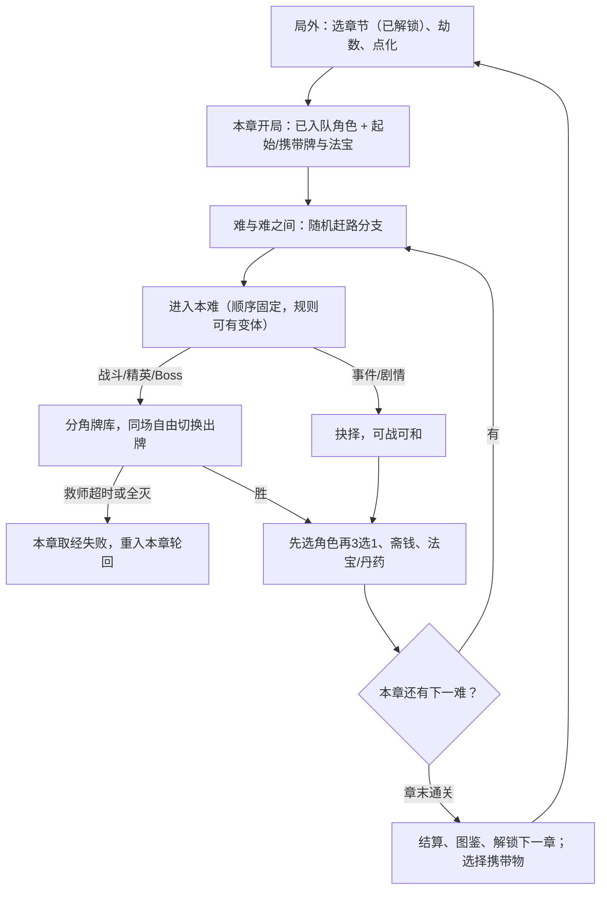

# 西游肉鸽卡牌 · 核心设计方案 v2

> 本版依据用户拍板更新主方向：  
> **（1）八十一难按原著第九十九回清单的顺序逐难推进**，不再按幕随机抽样；肉鸽随机性保留在难与难之间的赶路、奖励、事件、商店与卡牌构筑上。  
> **（2）师徒按剧情入队，单玩家操控全队，多人同场出牌、协同作战。**  
> **（3）主模式已定稿：一章一局，通关解锁下一章，轻度携带。**  
> **（4）战斗已定稿：每人各自一套牌和灵力（分角小牌库 + 个人费用）。细则、起始牌与第一章原型见 [design-v2-combat.md](./design-v2-combat.md)。**  
> 种族六族、卡牌稀有度与悲悯、法宝/丹药框架、评分原则仍以 `design-v1.md` 与 `design-v1-roguelike.md` 为准，本稿只改写被这些方向牵动的部分。  
> 难名以第九十九回难簿为准（八十难见于簿，第八十一难为观音补生，取通行称「老鼋作祸」）。第六难原著作「折从落坑」，亦有本作「落坑折从」。

---

## 0. v2 一句话与 v1 的差异

玩家带领取经队伍，**按八十一难的既定顺序**西行，边走边构筑牌组。唐僧开局，之后在第 8、9、12、16 难依次收入悟空、白龙马、八戒、沙僧，全员可在同一战场出牌。

| 项目 | v1 | v2 |
|------|----|----|
| 关卡结构 | 3 幕从难池抽样 + 灵山 | **81 难固定顺序**，分成 9 章；难与难之间插入随机赶路 |
| 角色模型 | 「一生四随」，先做悟空 | **剧情入队的五人队伍**，同场协同 |
| 一局长度 | 3 幕约 40～60 分钟 | **主模式已定：一章一局**（约 40～70 分钟），通关解锁下一章，轻度携带。「一气呵成」仅日后附设 |
| 战斗模型 | 单人一套牌，或曾拟「合牌共用 3 费」 | **已定：分角小牌库 + 个人灵力**；每回最多激活 2 名弟子，唐僧必可操作。合牌方案作废 |
| 开局选角 | 每局选 1 名主角 | 正传模式不选角，按故事入队；点化与劫数仍可选 |

---

## 1. 八十一难完整顺序与九章划分

分章原则：尽量把同一故事弧（如通天河、火焰山、狮驼岭、无底洞）放在一章内；每章约 7～12 难。章与章在寺庙/国度歇脚，作为存档与结算点。

**入队节点（固定）：**

| 角色 | 入队之难 | 说明 |
|------|----------|------|
| 唐僧 | 开局（难 1） | 人族，后排经主。难 1～4 为出身剧情链 |
| 孙悟空 | **难 8 · 两界山头** | 压在五行山，揭帖得救，妖族主战 |
| 白龙马 | **难 9 · 陡涧换马** | 鹰愁涧小龙，入队为龙族坐骑/可化龙人 |
| 猪八戒 | **难 12 · 收降八戒** | 高老庄，妖族肉盾 |
| 沙僧 | **难 16 · 收得沙僧** | 流沙河，妖族护法 |

难 8 之前仅唐僧（及会在难 6 折损的凡从），战斗教学偏「护僧、求生」；收悟空后才进入标准肉鸽手感。

### 第一章 · 金蝉出关（难 1～9）

章末高潮：两界山收大圣，随后陡涧换马。建议以「两界山头」为章内 Boss 级仪式战，难 9 作为收编事件 + 短战，通关本章。

| 难 | 名称 | 类型 | 机制点子 |
|----|------|------|----------|
| 1 | 金蝉遭贬 | 剧情 | 开局过场。可获得佛缘（护体或一张经文），并带 1 张「贬谪」诅咒入组，提示本局要靠取经洗净。 |
| 2 | 出胎几杀 | 剧情/事件 | 短事件：保胎/避祸。成功则最大生命微加，失败开局略残。 |
| 3 | 满月抛江 | 剧情/事件 | 漂流金山。选项影响起始斋钱或得「江流」牌（过牌/脱困）。 |
| 4 | 寻亲报冤 | 剧情/事件 | 可打一场弱仇敌（人族）。偏过场，首次必玩，重开可速过。 |
| 5 | 出城逢虎 | 战斗 | 第一场正式战。虎精攻高，教防御与护僧；唐僧几乎不能硬钢。 |
| 6 | 折从落坑 | 战斗+剧情 | 从人阵亡（示范「同伴倒下」）。太白金星来救：回血或得一张「呼救」牌。 |
| 7 | 双叉岭上 | 事件/战斗 | 猎户刘伯钦送一程：等同休息（化缘或默经），或再打山寇。 |
| 8 | 两界山头 | Boss/剧情 ★收悟空 | 揭帖、受戒。可做成「降服大圣」仪式战（先打金箍，再入队）。悟空带着金箍棒与起始妖牌入组。 |
| 9 | 陡涧换马 | 事件+战斗 ★收白龙马 | 鹰愁涧小龙。打或收；收后得龙马：马形态减伤赶路，龙人可出水系牌。 |

### 第二章 · 四众成行（难 10～16）

入队：难 12 八戒，难 16 沙僧。章末建议：黄风怪为章内 Boss，「收得沙僧」为收编高潮并通关。

| 难 | 名称 | 类型 | 机制点子 |
|----|------|------|----------|
| 10 | 夜被火烧 | 事件 | 观音院。谁守袈裟？选错则寺庙起火，掉血或丢失一件临时遗物。 |
| 11 | 失却袈裟 | 精英 | 黑风怪熊罴。开战可能先封「锦襕袈裟」；击败夺回，或事件求观音。 |
| 12 | 收降八戒 | 精英+剧情 ★收八戒 | 高老庄。先打猪妖，再劝降。八戒入队：高生命、钉耙、口腹被动。 |
| 13 | 黄风怪阻 | Boss | 迷眼（手牌背面朝上）。硬打很疼。 |
| 14 | 请求灵吉 | 事件 | 求「定风丹」则本场关闭迷眼；不求可省人情、得额外功德或硬刚。 |
| 15 | 流沙难渡 | 战斗/环境 | 流沙层数，类似浸水；打出龙/佛/稳行牌减层。 |
| 16 | 收得沙僧 | 精英+剧情 ★收沙僧 | 九次出没后受戒。沙僧入队：担经（遗物转护甲）、可后排护唐僧。四人齐，本章结。 |

### 第三章 · 心猿初贬（难 17～23）

章末 Boss：黄袍怪（金銮殿变虎）。白骨精为章内关键特殊 Boss，并触发「贬退悟空」因果。

| 难 | 名称 | 类型 | 机制点子 |
|----|------|------|----------|
| 17 | 四圣显化 | 事件 | 黎山老母等试婚。受或拒都有奖罚；人族唐僧选项更多，八戒易踩坑。 |
| 18 | 五庄观中 | 事件 | 人参果：偷、要、或恪守。偷吃大补，可能被发现。 |
| 19 | 难活人参 | 事件/Boss | 镇元子问罪。耗资源医树，或打一场「仙」战（劝和不杀）。 |
| 20 | 贬退心猿 | Boss | **三打白骨精**：三形假死，可看破；打错则「师傅责难」，并可能 **临时贬走悟空**（其牌暂离牌组 1～2 难）。 |
| 21 | 黑松林失散 | 事件/战斗 | 队伍失散，本场也许只剩唐僧+部分弟子；强调护僧。 |
| 22 | 宝象国捎书 | 事件 | 捎书、潜入或强闯，影响下一场开局。 |
| 23 | 金銮殿变虎 | Boss | 黄袍怪（奎木狼）。唐僧被变/被占；未归队的悟空若仍在贬途，则本场更难，打赢可迎回。 |

### 第四章 · 火云洞府（难 24～32）

章末 Boss：红孩儿（请圣降妖）。金角银角为章中大 Boss。

| 难 | 名称 | 类型 | 机制点子 |
|----|------|------|----------|
| 24 | 平顶山逢魔 | 精英 | 金角银角前哨、小妖巡山，可能先丢一件法宝线索。 |
| 25 | 莲花洞高悬 | Boss | 葫芦/紫金红葫芦点名「收」一张牌或一名弟子（本场禁出）。需叫名/特定牌反制。 |
| 26 | 乌鸡国救主 | 事件+战斗 | 井中救驾、辨真假国王。火眼可直接识破。 |
| 27 | 被魔化身 | Boss | 文殊坐骑青狮。假国王战，打赢或请菩萨，偏「识破 + 克制」。 |
| 28 | 号山逢怪 | 精英 | 红孩儿前哨，开始叠燃烧。 |
| 29 | 风摄圣僧 | 特殊事件 | **唐僧被劫开场**，进入救师（见第 2 节）。 |
| 30 | 心猿遭害 | Boss | 三昧真火：每回合烧牌或烧血；棍棒近战挨克，需借水/钻地/换位。 |
| 31 | 请圣降妖 | Boss尾/事件 | 请观音则战斗简化、得净瓶相关，少一份厚赏；硬打风险高、掉落更好。 |
| 32 | 黑河沉没 | 精英 | 鼍龙掀河。白龙马在场可多一个「唤龙」选项或减浸水。 |

### 第五章 · 河国法宝（难 33～41）

章中大轴：通天河灵感大王。章末 Boss：金兜山青牛精（金刚琢）。

| 难 | 名称 | 类型 | 机制点子 |
|----|------|------|----------|
| 33 | 搬运车迟 | 事件 | 苦役搬车，换通关或斋钱；可闹事提前开战，得罪国王。 |
| 34 | 大赌输赢 | 事件+战斗 | 比求雨、隔板猜物等。胜得删牌/非凡牌，败则强制进下一难且已受伤。 |
| 35 | 祛道兴僧 | Boss | 虎力、鹿力、羊力连环或同场。破「假仙」后按妖结算。 |
| 36 | 路逢大水 | 事件 | 陈家庄献祭。代战 + 功德；无视则省力，但留下 **通天河因果**。 |
| 37 | 身落天河 | Boss | 灵感大王。浸水层数；去程未善了则更狠。 |
| 38 | 鱼篮现身 | 事件/Boss尾 | 请观音鱼篮可收；不请则再打一程。影响是否「根除」（关系到回程，见难 81）。 |
| 39 | 金兜山遇怪 | 精英 | 纳锦背心等诱饵，入洞前先削资源。 |
| 40 | 普天神难伏 | Boss | **金刚琢缴械**：攻击牌费用 +1 或起始法宝暂时失效，直到讨还。 |
| 41 | 问佛根源 | 事件/Boss尾 | 问如来、老君收牛。可还宝、得金刚琢或仙家丹药，不强制击杀。 |

### 第六章 · 欲火真假（难 42～49）

章末 Boss：牛魔王。六耳猕猴为章中特殊 Boss。

| 难 | 名称 | 类型 | 机制点子 |
|----|------|------|----------|
| 42 | 吃水遭毒 | 事件 | 子母河：「身孕」状态（手牌 -1 或每回合掉血），落胎泉或丹药可解。 |
| 43 | 西梁国留婚 | 事件 | 招亲。受赠则大补 + 诅咒「情丝」；拒婚或逃婚可能追兵。可不战而过。 |
| 44 | 琵琶洞受苦 | Boss | 蝎子精。毒与蜇；**唐僧被摄**，倒钩刺克某些防具，需昴日一类克制或硬抗。 |
| 45 | 再贬心猿 | 事件/战斗 | 强盗。再起冲突则悟空再次暂离；忍与不忍都改写难 46 的开局。 |
| 46 | 难辨猕猴 | Boss | 六耳镜像：复制牌组/法宝；辨真，打错则治疗对手或误伤悟空。火眼、紧箍、佛牌可标记。 |
| 47 | 路阻火焰山 | 事件/环境 | 全局酷热。无扇则后续两难都带环境伤害。 |
| 48 | 求取芭蕉扇 | 精英/事件 | 向铁扇公主借、骗、抢。可能得假扇。 |
| 49 | 收缚魔王 | Boss | 牛魔王多阶段（变牛、借兵等）。有真扇则规则大幅改写。 |

### 第七章 · 假佛迷情（难 50～60）

本章偏长（11 难），设两个高潮：黄眉为章中大 Boss，百眼魔君为章末 Boss。

| 难 | 名称 | 类型 | 机制点子 |
|----|------|------|----------|
| 50 | 赛城扫塔 | 事件 | 金光寺扫塔、辨冤，得线索与功德，或与僧众冲突。 |
| 51 | 取宝救僧 | Boss | 九头虫、万圣龙王。多头再生，水战；龙马有加成。 |
| 52 | 棘林吟咏 | 事件 | 树精联句。答对和平过；八戒莽打可得牌但结怨或少功德。 |
| 53 | 小雷音遇难 | Boss | 假佛赐福实为陷阱；金铙封手牌或封一名弟子。 |
| 54 | 诸天神遭困 | Boss续 | 人种袋等，收角色入袋（本场倒地规则的加强版）。请弥勒或破袋。 |
| 55 | 稀柿衕秽阻 | 事件/战斗 | 路阻与恶臭（持续掉血或费用 +1）。蟒可战；八戒在场多「拱路」选项。 |
| 56 | 朱紫国行医 | 事件 | 揭榜行医，得斋钱、稀有药，或识破病源直接钩出下一难。 |
| 57 | 拯救疲癃 | 事件 | 炼「乌金丹」类。成功得丹药/治疗牌，失败浪费材料。 |
| 58 | 降妖取后 | Boss | 赛太岁（金毛犼）。绑票皇后；紫金铃类法宝干扰费用或手牌。 |
| 59 | 七情迷没 | 精英 | 七蜘蛛。蛛网：部分手牌暂时打不出；多敌。 |
| 60 | 多目遭伤 | Boss | 百眼魔君。多目锁定（点名后排唐僧）；需克制或破眼。 |

### 第八章 · 魔城鼠洞（难 61～69）

章中超级 Boss：狮驼岭三魔连环。章末 Boss：地涌夫人（无底洞）。

| 难 | 名称 | 类型 | 机制点子 |
|----|------|------|----------|
| 61 | 路阻狮驼 | 精英 | 小钻风、探路；阴阳二气瓶可先收一名弟子。 |
| 62 | 怪分三色 | Boss | 狮、象、鹏分色轮战或同场，短喘息。 |
| 63 | 城里遇灾 | Boss续 | 狮驼国城内，环境更压迫，唐僧被吞/被困风险高。 |
| 64 | 请佛收魔 | Boss终 | 大鹏极难硬杀；请如来则能收，少掉落、多佛缘。本章最高压段落。 |
| 65 | 比丘救子 | 事件 | 救 1111 小儿心的国难。耗资源换大功德与民心，或潜入少报。 |
| 66 | 辨认真邪 | Boss | 国丈白鹿。媚药/伪药扰乱治疗牌；识破则削弱。 |
| 67 | 松林救怪 | 事件 | 地涌夫人假扮落难。救或不救改写 68～69；火眼可看破。 |
| 68 | 僧房卧病 | 事件 | 唐僧得病（经主每回合掉血或不能出经文），需寻因。 |
| 69 | 无底洞遭困 | Boss | 老鼠精摄僧入洞。迷宫式多阶段 + 救师；或请李天王/猫类克制。 |

### 第九章 · 九九归真（难 70～81）

章中：灭法、犀牛、天竺玉兔。终局：凌云渡脱胎 + 老鼋补难。通关第九章 = 正传取经成功。

| 难 | 名称 | 类型 | 机制点子 |
|----|------|------|----------|
| 70 | 灭法国难行 | 事件/战斗 | 夜入杀僧之国。潜行（事件检定）或连战；暴露则全国追剿。 |
| 71 | 隐雾山遇魔 | 精英/Boss | 南山大王（豹）。迷雾：与黄风类似的视认干扰，偏短。 |
| 72 | 凤仙郡求雨 | 事件 | 祈雨。龙马/功德/诵经可和平解决，得郡中补给；失败则旱灾惩罚（商店枯竭）。 |
| 73 | 失落兵器 | 事件 | 三犀盗走武器型法宝或「棒/耙/杖」牌降效，直到讨还。 |
| 74 | 会庆钉钯 | 事件/战斗 | 寻回钉钯等。八戒不在场（若倒地）则更麻烦。 |
| 75 | 竹节山遭难 | 精英 | 三犀前哨，寒暑尘等元素环境。 |
| 76 | 玄英洞受苦 | Boss | 辟寒、辟暑、辟尘同场或轮换，克制不全则持续受苦。 |
| 77 | 赶捉犀牛 | Boss尾/事件 | 请昴日星官等则收束；追击可多一件法宝。 |
| 78 | 天竺招婚 | Boss | 玉兔假公主。招亲戏 + 辨假；唐僧再陷留婚压力，打假不打真国王。 |
| 79 | 铜台府监禁 | 事件 | 寇员外案，入狱。资源被扣，靠事件或越狱战索回，考薄牌组。 |
| 80 | 凌云渡脱胎 | 事件/试炼 | 无底船。偏「禅心」：牌组越洗练越好的心魔战，或脱胎规则（弃掉诅咒、升级起始牌）。 |
| 81 | 老鼋作祸 | 事件+终局 | 观音补生，九九归真。若通天河未问老鼋、或未根除灵感大王，则翻船湿经：一场追兵/捞经战，经卷类增益暂时失效。妥善因果则可减弱。打赢即正传通关。 |

---

## 2. 多人同场战斗机制

此处「多人」指 **师徒多角色同场**，由 **一名玩家操控全队**（不是联机各操一人）。网页与小游戏先按此做。

### 2.1 设计目标

- 能看出「谁在打」：牌有所属，站位有前后，倒下有后果。
- 操作不能随着入队人数线性膨胀（小游戏尤其怕五套费用、五手牌）。
- 唐僧弱而不可缺，被劫是特色，不是动不动就整局作废的陷阱。

### 2.2 牌组、费用、抽牌（已定：分角小牌库 + 个人灵力）

详细规则、起始牌与第一章原型见 [design-v2-combat.md](./design-v2-combat.md)。此处只留定稿摘要：

- **每人独立牌库、手牌、弃牌堆、灵力。** 起始 5～8 张；弟子灵力上限 3、激活时抽 3；唐僧有同伴时灵力 2、抽 2（独立出战升为 3/3）。
- **同一玩家回合，已激活角色之间可自由切换出牌**，各花各的灵力；不采用「打完一人再轮下一人」的分段回合。
- **操作量控制（推荐并采用）：每回合最多激活 2 名弟子；唐僧在场且未被劫则每回自动激活，不占这 2 个名额。** 未激活弟子不抽牌、不回灵力，回合结束得 4 点守势护甲。不另加总出牌数上限。
- 协同牌仍要求相关角色在场。唐僧的「紧箍咒」在悟空入队时洗入唐僧自己的牌库。
- 奖励先指定角色，再从该角色牌池 3 选 1；商店删牌/升级先选角色；删牌价格按角色分别累加。

### 2.3 站位与受伤

- 两排：**前排最多 2 人，后排最多 3 人**。开战可调，战斗中用换位牌或花 1 费换位（每回合限一次）。
- **唐僧锁定后排**，不能主动站前排。
- 建议默认：前排悟空 + 八戒，后排唐僧、沙僧（护法）、白龙马（马形态不占前排名额，化龙人则可上前）。
- **敌人普通攻击打前排**（若两人则随机或按「嘲讽 / 凶芒」分配）。前排清空后，后排暴露，唐僧会被直接打到。
- 点名技能（风摄、蛛丝、多目锁定、葫芦收人）可以 **指定后排**，这是救师战的来源。
- 每名角色 **独立生命**（草案：唐僧 40、悟空 70、八戒 80、沙僧 75、白龙马 65）。护甲按角色计算。角色被动按自身种族结算（见第 4 节）。

### 2.4 角色倒下、暂离、全灭

- **弟子倒下：** 生命到 0 则本场昏迷，站位空出，**其整套牌库/手牌/灵力本场冻结**。**战斗胜利后以 30% 生命（至少 1 点）站起**，牌库保留，需休息/丹药才能恢复健康。不在第一版做弟子永久死亡。
- **贬退 / 被收 / 入袋：** 与倒下不同，是叙事性「暂离」——离开若干难或本场，**整库与角色法宝随人带离**，不参与选卡；战斗结束或相应难过完后按离开时的内容归还。白骨精、再贬心猿、金铙/葫芦/阴阳瓶都会用到。
- **唐僧倒下：** 不立刻判负，进入 **救师状态**（下节）。
- **全队可战弟子倒下且唐僧仍在、却救不回：** 若连续一轮无法使任何弟子复起（无还魂、无召援），则取经失败（「从人尽折」）。
- **真全灭或救师超时：** 本局（本章）结束，重入轮回。

### 2.5 唐僧在队中的作用与「被劫」

唐僧是 **经主与胜负轴**，不是主输出：

- 人族「志心」+ 佛缘：经文、净化、护体、克鬼、事件里的慈悲选项。
- 紧箍：约束/强化悟空的关键按钮。
- 化缘、功德、佛门事件常看他在不在场。

**被劫（推荐）：当作特殊机制，而不是「唐僧掉一滴血就失败」。**

- 唐僧生命到 0，或被点名技能「摄走」：进入 **救师**。限 **2～3 回合** 内把唐僧救回（打爆劫者、破阵、打出救师牌），否则 **本章失败**。
- 救师期间：唐僧离场，不能出经文；敌人可能少一个攻击目标但会有「撕票」倒计时。
- 若干难 **开场就进入救师**（风摄圣僧、琵琶洞、无底洞、金銮殿等），这是这些难的独特规则，不是惩罚。
- 还魂丹可对唐僧使用，缩短或避免超时。

这样既保留「保护师傅」的紧张感，又不会因为一次点名而理亏地结束整章。

---

## 3. 固定顺序下的肉鸽随机性，与一局长度

### 3.1 随机性放在哪里（顺序不变，过程多变）

81 难的 **出现顺序不随机**，重玩性靠下面几层：

1. **难与难之间的赶路图。** 每两难之间生成一小段分支（约 2～4 个节点）：普通战、小事件、商店、休息/化缘、险地。权重和定价沿用 v1 肉鸽稿。玩家可走安全路（多休息、少奖励）或险路（精英、险地）。**不能跳过正难本身。**
2. **同一难的随机变体与因果。** 例如白骨精能否看破、悟空是否被贬；芭蕉扇真假；通天河是否根除，将改写第 81 难；松林是否救「落难女子」改写无底洞。同一难可有 2～3 个规则变体（敌人词条、开场被劫与否、可和平选项是否出现）。
3. **奖励与构筑仍全随机。** 战斗后先指定角色，再从该角色牌池 3 选 1；稀有度与悲悯按角色分别计算。法宝/丹药掷骰、商店货架、观音点化仍按 v1 肉鸽稿。这是重玩的主轴：这一局给悟空堆分身还是给龙马堆水系，过的是同一座火焰山，体感会不同。
4. **章内路线。** 正难顺序固定，但赶路拓扑每局重生成；部分「可和平解决」的难（女儿国、凤仙郡祈雨、棘林吟咏）提供战斗/事件两条解决，奖励不同。
5. **队伍状态随机演化。** 谁残血、谁被贬、带了哪件法宝，会改变后面固定难的打法（无悟空打宝象国、无扇打火焰山）。
6. **劫数与点化。** 同章不同难度、不同出门缘法。

**不做的事：** 打乱 81 难顺序、随机抽 Boss 章末、用无名小妖替换正难。那会直接违背本次拍板。

### 3.2 一局长度：81 难一气打完太长

粗算：一难含战斗或事件约 3～8 分钟，加上赶路，81 难可能 **6～10 小时**，不适合肉鸽重开，也不适合微信小游戏。

**主模式已拍板：分章成局 + 轻度携带 + 章节解锁。**

| 规则 | 草案 |
|------|------|
| 一局 | **一章**（7～12 难 + 赶路），目标 **40～70 分钟** |
| 死亡 | 仅本章失败，回本章开局重入轮回；不强迫从难 1 再走（除非玩家选「重新取经」） |
| 解锁 | 通关本章解锁下一章；可回打旧章刷图鉴、劫数、构筑 |
| 章间携带 | **轻度（定稿）**：下一章开局重置各人构筑，保留已入队角色的 **各自起始牌库 + 角色起始法宝**；再让玩家 **自选携带 1 件法宝 + 最多 2 张已升级牌**（须标明归属，回到该角色牌库）。最大生命的永久加成不携带。进入下一章再做一次观音点化。避免第一章超级牌组碾压第九章 |
| 存档 | 章内 **每个正难开始前** 可退出，回来从「上一难通关后、本难开始前」续开（防止小游戏中断）；**不在战斗中途读档**。本章一旦全灭，该存档作废，须重打本章 |
| 难 1～4 | 首次必玩；之后开第一章可「诵前缘」速过，只保留一个简短点化 |

**附设模式：「一气呵成」。** 从第一章打到第九章，章末为存档点，牌组与法宝 **全程继承**（更像长线冒险）。死亡回 **当前章首**。给成就与高分，不当小游戏默认模式。

第一版只做主模式；一气呵成可后补，不当默认。

### 3.3 单章流程（简图）

---

## 4. 对种族、劫数、局外成长的修正

### 4.1 种族

六族与轻克制表 **不改**。变化在于：**场上会同时存在多人多种族被动**。

- 各角色只结算 **自己的** 种族被动（唐僧走人的志心与化缘加成；悟空走凶芒；龙马走龙鳞与云雨；不共享「全队都算妖」）。
- 打出的牌按 **出牌角色的种族** 与 **目标种族** 计算克制（佛牌仍克妖鬼，即使持牌者是人族唐僧）。
- 全队混编后，选牌要兼顾：前排妖族吃雪球，后排人/龙/佛缘负责站场与克制。这是五人同场的构筑趣味。
- v1「先做单人悟空、佛缘分支改本相」让位于：悟空始终是妖，唐僧在场自然提供佛缘牌与紧箍，不必再给悟空单独改族。

### 4.2 劫数（0～15 仍叠加，用词从「幕」改为「章」）

原表大部分可直接迁移，需改写的条目：

| 劫数 | v1 表述 | v2 调整 |
|------|---------|---------|
| 4 | 每幕保底 2 精英 | 改为：本章 **赶路段** 至少 2 个精英节点；具名精英难本身强度 +10% |
| 5 | 开局 80% 生命 | 改为：本章开局全队生命为各自上限的 80% |
| 10 | 开局一张「业障」 | 放入 **一名已入队角色的牌库**（第一章默认唐僧；也可开局让玩家选） |
| 12 | 普通战 2 选 1 | 只作用于赶路普通战与非 Boss 正难；章内 Boss / 特殊难仍 3 选 1 |
| 14 | 强制灵山高难终局 | 改为：打第九章时，难 80～81 **必打完整试炼**（不可和平速过） |
| 15 | 九九归真综合强化 | 再加 1 诅咒、未格挡伤害 +1；且第九章 Boss 与补难再强化 |

其余（敌人变厚、物价、回血减少、丹药栏、小妖/精英多词条）保持 v1，作用于全章敌人与节点。劫数是账号已解锁的全局难度，**进任何一章前都可选择**；「正传完全通关」可要求第九章在指定劫数以上再打一次。

### 4.3 局外成长

仍坚持：**解锁内容，不叠加永久攻防。**

新增与调整：

- **章节解锁：** 通关上一章才开下一章。可回打已解锁章。
- **角色：** 正传不靠成就解锁师徒，而靠难 8/9/12/16 的剧情入队。若某章起始已过入队点（如从第三章开局），则开局即拥有已入队四人。
- **81 难图鉴：** 按顺序记录：见过、度过、变体、因果（贬过悟空、根除过通天河、持真扇等）。齐套给称号或一条点化，仍不给永久伤害。
- **卡牌与法宝解锁：** 仍可按「第一次通关某难 / 第一次收某徒」把更深层的牌放进奖励池，避免第一章池子过大。
- **携带物：** 只在分章模式的章间生效，见 3.2，不属于永久数值养成。
- v1「每局选主角」的局外解锁，改为可选的 **自由模式**（日后）：自选开局队伍或单人挑战某章，不替代正传。

---

## 5. 建议的落地顺序（v2）

1. 先做 **第一章**（难 1～9）可玩原型：唐僧开局 → 从人教学 → 收悟空 → 收龙马，跑通分角牌库、激活、自由切换、倒下与赶路。范围清单见 `design-v2-combat.md` 第 4 节。  
2. 再做 **第二章**，验证八戒、沙僧入队后「三名弟子激活两人」的取舍与护僧。  
3. 补白骨精（贬退整库离队）、救师战各一场样板。  
4. 再按章向后填具名难、劫数 0～5、图鉴与章间携带。

---

*文档版本：v2 · 仅设计，不含实现。正传结构、81 难与救师以本文为准；主模式细节、分角战斗、起始牌与第一章原型以 design-v2-combat.md 为准；卡牌经济、稀有度、法宝框架仍参见 v1。*
